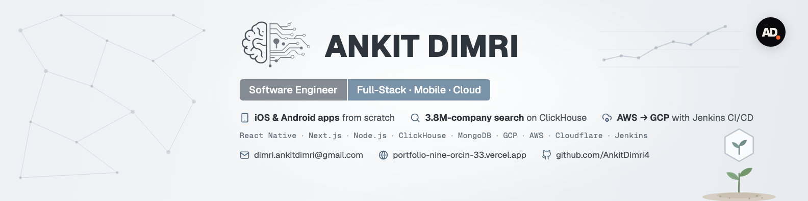
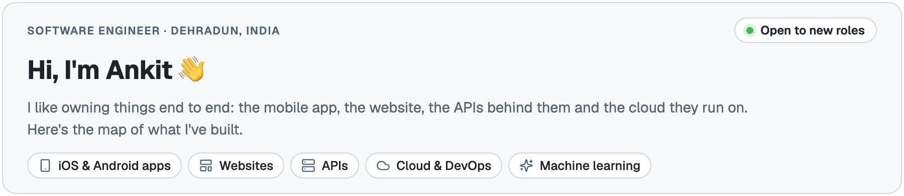
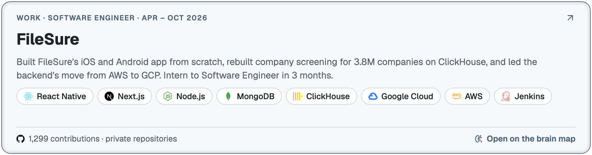
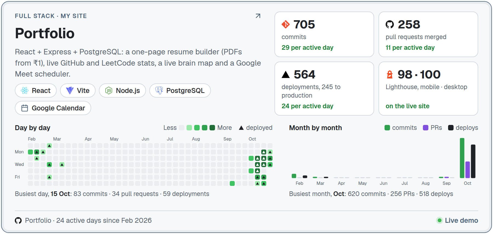
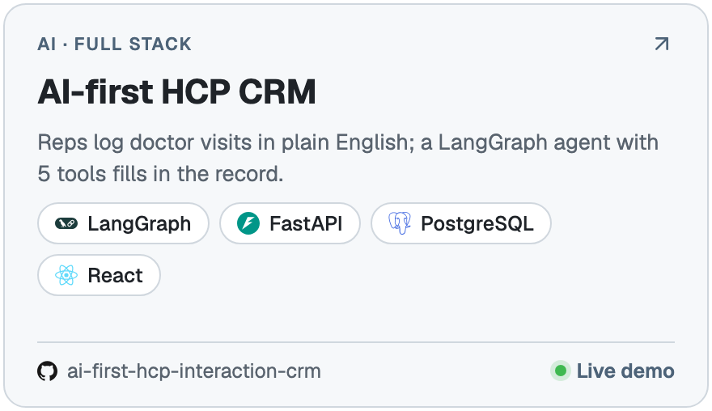
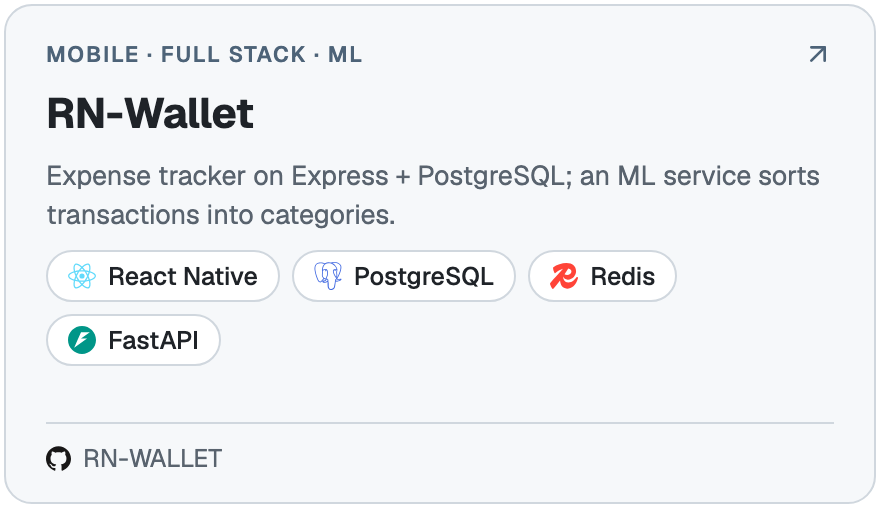
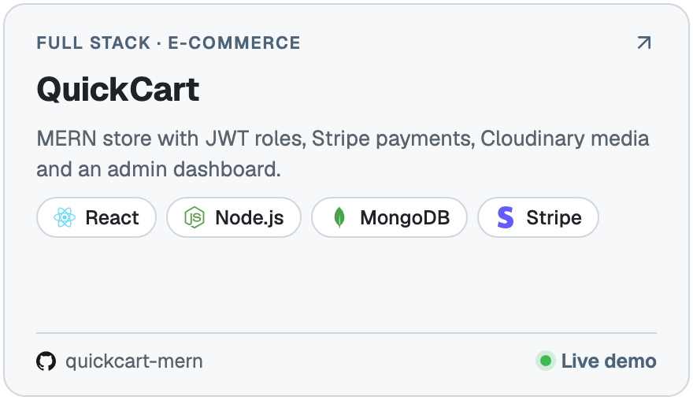
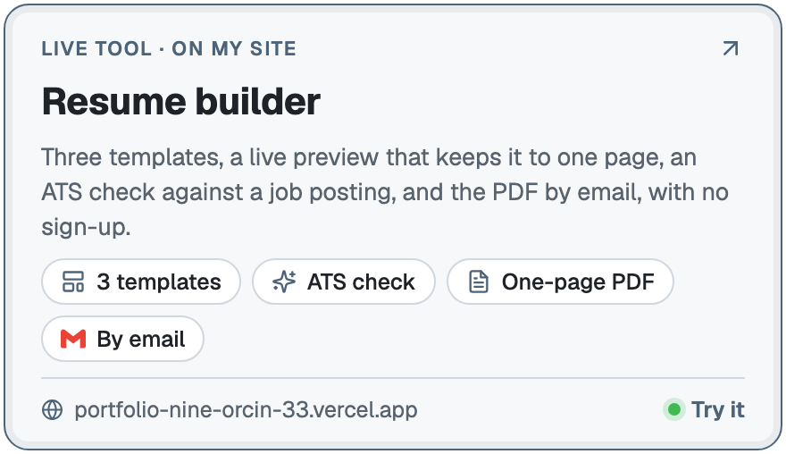
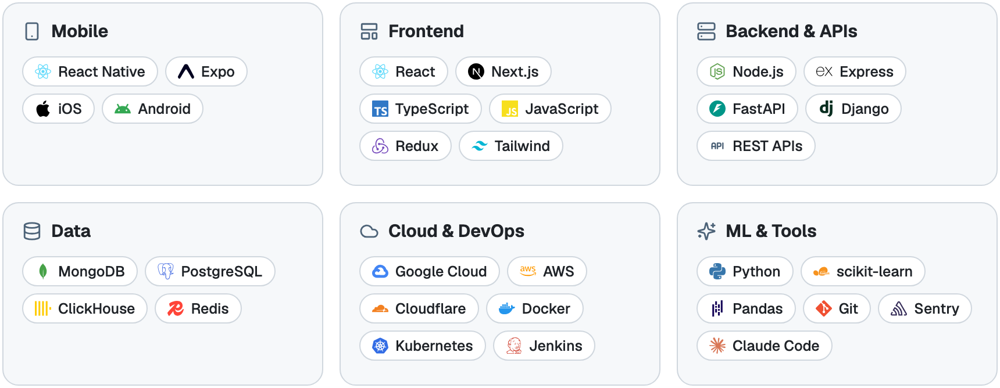

<a href="https://portfolio-nine-orcin-33.vercel.app/"><picture><source media="(prefers-color-scheme: dark)" srcset="assets/cards/intro-dark.png"></picture></a>

<picture>
  <source media="(prefers-color-scheme: dark)" srcset="assets/brain-map-dark.png">
  
</picture>

  <a href="https://portfolio-nine-orcin-33.vercel.app/brain-map/">
    <picture>
      <source media="(prefers-color-scheme: dark)" srcset="assets/live-button-dark.png">
      
    </picture>
  </a>

> My 2026 work (April–October) was in FileSure's private repositories, so the code isn't public. The graph below includes those contributions.

### Work

<a href="https://portfolio-nine-orcin-33.vercel.app/brain-map/#filesure"><picture><source media="(prefers-color-scheme: dark)" srcset="assets/cards/work-filesure-dark.png"></picture></a>

  <a href="https://apps.apple.com/in/app/filesure/id6759514259"><picture><source media="(prefers-color-scheme: dark)" srcset="assets/cards/link-ios-dark.png"></picture></a>
  <a href="https://play.google.com/store/apps/details?id=in.filesure"><picture><source media="(prefers-color-scheme: dark)" srcset="assets/cards/link-android-dark.png"></picture></a>
  <a href="https://www.filesure.in"><picture><source media="(prefers-color-scheme: dark)" srcset="assets/cards/link-website-dark.png"></picture></a>
  <a href="https://portfolio-nine-orcin-33.vercel.app/brain-map/#filesure"><picture><source media="(prefers-color-scheme: dark)" srcset="assets/cards/link-brainmap-dark.png"></picture></a>

### Projects

  <a href="https://github.com/AnkitDimri4/Portfolio"><picture><source media="(prefers-color-scheme: dark)" srcset="assets/cards/project-portfolio-dark.png"></picture></a>

  <a href="https://github.com/AnkitDimri4/ai-first-hcp-interaction-crm"><picture><source media="(prefers-color-scheme: dark)" srcset="assets/cards/project-hcp-crm-dark.png"></picture></a>
  <a href="https://github.com/AnkitDimri4/RN-WALLET"><picture><source media="(prefers-color-scheme: dark)" srcset="assets/cards/project-rn-wallet-dark.png"></picture></a>

  <a href="https://github.com/AnkitDimri4/quickcart-mern"><picture><source media="(prefers-color-scheme: dark)" srcset="assets/cards/project-quickcart-dark.png"></picture></a>
  <a href="https://portfolio-nine-orcin-33.vercel.app/resume-builder/"><picture><source media="(prefers-color-scheme: dark)" srcset="assets/cards/project-resume-builder-dark.png"></picture></a>

### Tech I use

<a href="https://portfolio-nine-orcin-33.vercel.app/#stack"><picture><source media="(prefers-color-scheme: dark)" srcset="assets/cards/stack-dark.png"></picture></a>

### Find me

  <a href="https://portfolio-nine-orcin-33.vercel.app/#schedule"><picture><source media="(prefers-color-scheme: dark)" srcset="assets/cards/link-schedule-dark.png"></picture></a>
  <a href="https://portfolio-nine-orcin-33.vercel.app/"><picture><source media="(prefers-color-scheme: dark)" srcset="assets/cards/link-portfolio-dark.png"></picture></a>
  <a href="https://portfolio-nine-orcin-33.vercel.app/resume"><picture><source media="(prefers-color-scheme: dark)" srcset="assets/cards/link-resume-dark.png"></picture></a>
  <a href="https://www.linkedin.com/in/ankit-dimri-a6ab98263"><picture><source media="(prefers-color-scheme: dark)" srcset="assets/cards/link-linkedin-dark.png"></picture></a>
  <a href="https://leetcode.com/u/user4612MW/"><picture><source media="(prefers-color-scheme: dark)" srcset="assets/cards/link-leetcode-dark.png"></picture></a>
  <a href="mailto:dimri.ankitdimri@gmail.com"><picture><source media="(prefers-color-scheme: dark)" srcset="assets/cards/link-email-dark.png"></picture></a>

